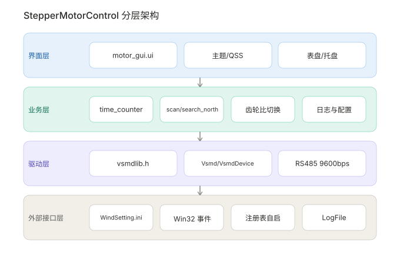
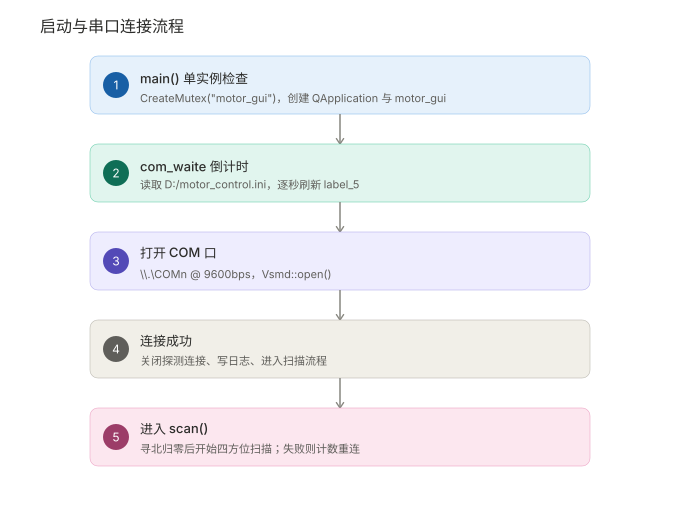
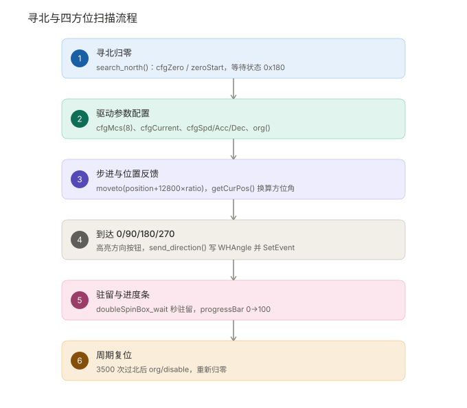
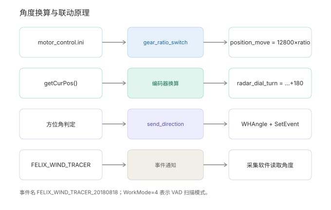

# 系统架构与关键流程

## 1. 分层架构

软件分为界面层、业务层、驱动层与外部接口层四层。



| 层次 | 组成 | 职责 |
|------|------|------|
| 界面层 | `motor_gui.ui`、`closeBox.ui`、QSS 主题、`dial`/`dial_2`、托盘图标 | 串口/齿轮比/速度选择、方位高亮、角度显示、进度条、窗口与托盘交互 |
| 业务层 | `motor_gui` 主窗口槽函数、`time_counter()`、`scan()`、`search_north()`、`thread_obj` | 连接管理、寻北、四方位扫描、电流速度配置、换算与状态机 |
| 驱动层 | `vsmdlib.h` 的 `Vsmd` / `VsmdDevice` | RS485 @ 9600 bps，电机使能与参数配置、原点/零位、位置与状态读取 |
| 外部接口层 | `D:\motor_control.ini`、`C:\WindSetting.ini`、具名事件、注册表 Run、`D:\LogFile` | 配置持久化、与采集程序联动、开机自启、运行日志 |

**数据流**：用户操作 → 槽函数 → `VsmdDevice` API → 电机/转台 → `getCurPos()`/`getStatus()` →
表盘与标签刷新；同时 → `SetInt(WHAngle/WorkMode)` → `WindSetting.ini`，
`SetEvent(FELIX_WIND_TRACER_20180818)` → 采集程序。

## 2. 关键流程一：启动与串口连接



1. `main()`：`CreateMutex(L"motor_gui")` 单实例检查，创建 `QApplication` 与 `motor_gui`；
2. `motor_gui` 构造函数：加载 QSS、托盘、`read_voltage()` / `load_speed()`、恢复 UI 状态、
   连接全部按钮信号，启动进度条线程；
3. `w.time_counter()` 同步调用：按 `com_waite` 倒计时，拼装 `\\.\COMn`；
4. `Vsmd::createVsmd(com, 9600)` → `createDevice(0)` → `open()`；
5. 成功则关闭探测连接、写日志并进入 `scan()`；失败则 `reconnect_counter++` 后重试，
   直至 `stop_scan` 为真退出。

## 3. 关键流程二：寻北与四方位扫描



1. `search_north()`：`send_model_id(0)`，保存齿轮比/串口/驻留时间，配置零位并 `zeroStart()`；
2. 轮询 `getStatus() & 0x180` 判定零位到达，超时 `over_time == 200` 退出，
   随后 `moveto(manual_turn * 142)` 完成手动角补偿；
3. `scan()` 外循环 `send_model_id(4)` 设 VAD 模式；`read_voltage()` 钳位电流；
4. `cfgCurrent` / `cfgSpd` / `cfgAcc` / `cfgDec` / `org()` 后进入 40 ms 内循环；
5. `show_deg` 到达 0/90/180/270 且 `move_deg > 30`：高亮方向按钮，
   `send_direction()` 写 `WHAngle` 并 `SetEvent`，进度条在驻留时间内 0→100；
6. `moveto(position + 12800 × ratio)` 推进到下一位；累计 3500 次过北后回零重寻北；
7. `stop_motor()` 置 `stop` / `stop_scan`，`org()` / `disable()` 安全停机。

## 4. 角度换算与联动原理



- 齿轮比来自 `comboBox_gear`，经 `gear_ratio_switch()` 映射为 `gear_ratio_float`；
- 单步位移 `position_move = 12800 × ratio`；单圈脉冲 `51200 × ratio`；
- `getCurPos()` 取模换算电机角与雷达角，四正交点附近 ±2° 吸附；
- `send_direction()` 通过 `C:\WindSetting.ini` 的 `WHAngle` 与具名事件
  `FELIX_WIND_TRACER_20180818` 把方位同步给采集程序；`WorkMode=4` 标识 VAD 扫描态。

## 5. 时序关系

```text
main ──> time_counter() ──> Vsmd::open() ──> scan()
                                              │
                         ┌────────────────────┼──────────────────┐
                         ▼                    ▼                  ▼
                 search_north()        40ms 轮询循环        thread_obj 进度条
                 (zeroStart)           (位置/状态/方位)      (bar_signal 0..100)
                                              │
                         ┌────────────────────┴──────────────┐
                         ▼                                   ▼
                  SetInt(WHAngle) + SetEvent            dial / label_3
                         │
                         ▼
                  采集程序读取 WindSetting.ini
```

- `time_counter()` 与进度条线程并行：前者控制串口/扫描主状态机，后者只负责 UI 进度反馈；
- 全局布尔量（`stop` / `stop_scan` / `close_window` / `start_process_bar`）承担跨流程协同，
  修改这些标志时应保持 `qApp->processEvents()` 以维持界面响应。
